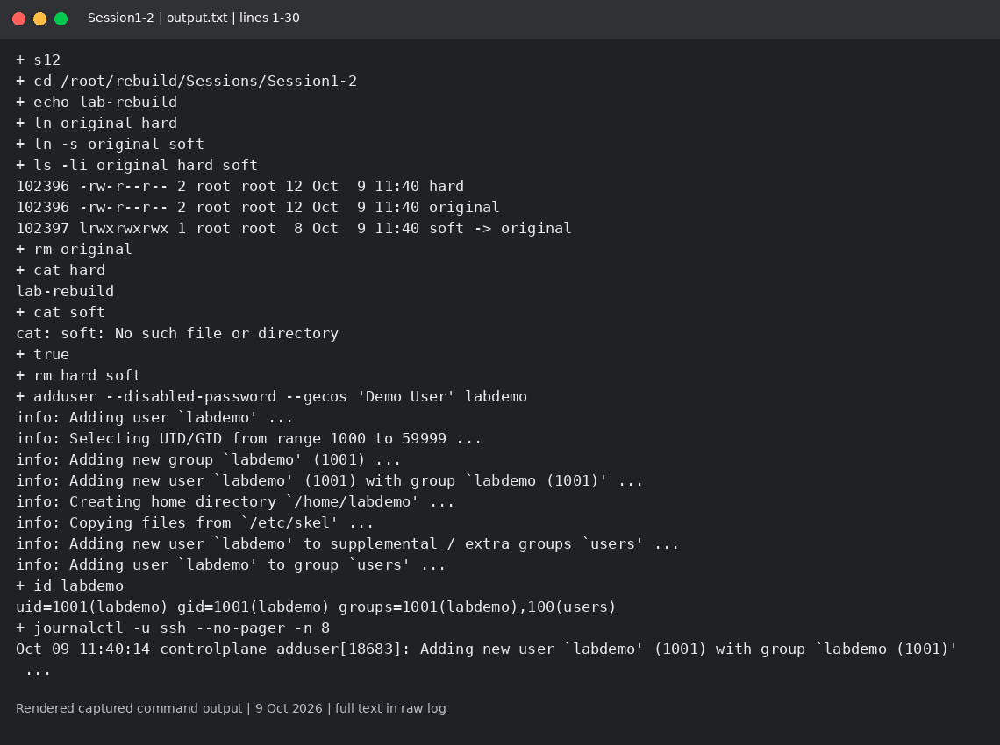
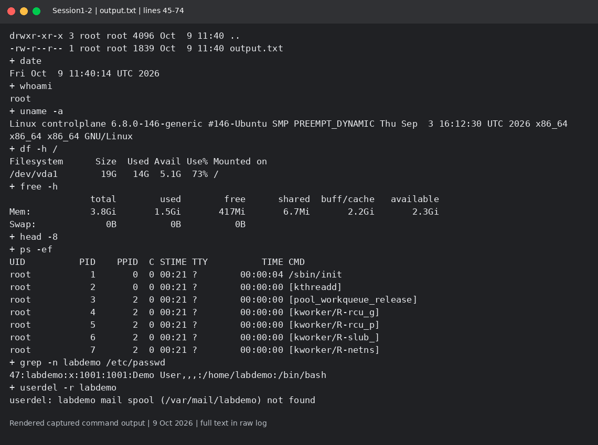

# Session 1-2: Linux fundamentals

Mohd Jahur | Enrollment 10319

## Work and observations

1. I created a hard link and a soft link, then removed the original. The hard link still read the data; the soft link no longer had a target.
2. I created and removed a demo user with adduser, checked its UID, read SSH service logs with journalctl, and practiced the Linux commands shown in the log.

## Evidence

Fresh run on 9 October 2026 in a separate disposable lab. These are rendered views of actual captured command output, not live terminal screenshots. Raw logs are included so the text can be checked.

<!-- EVIDENCE -->

## References

- https://manpages.ubuntu.com/manpages/noble/en/man8/adduser.8.html
- https://www.freedesktop.org/software/systemd/man/latest/journalctl.html

## Command notes

- Hard links share an inode and data with the original; they normally cannot cross filesystems or link directories. A soft link stores a path and can cross filesystems, but a removed target leaves it dangling.
- On Ubuntu, adduser is the friendlier policy-aware wrapper for interactive user creation. useradd is the lower-level tool; defaults and home-directory creation need attention. This lab used adduser with a disabled password.
- journalctl reads systemd journal entries. `journalctl -u ssh -n 8 --no-pager` selects recent SSH service entries; `journalctl -b` selects the current boot.

| Command | What I used it for |
| --- | --- |
| pwd, ls | Current folder and directory entries |
| mkdir, touch, echo, cat | Make files/folders and inspect their text |
| ln, ln -s | Hard and soft links |
| grep | Find the demo user's passwd entry |
| date, whoami, uname | Time, current identity and kernel |
| df, free, ps | Disk, memory and running processes |

## Captured output files

- [output.txt](output.txt)

