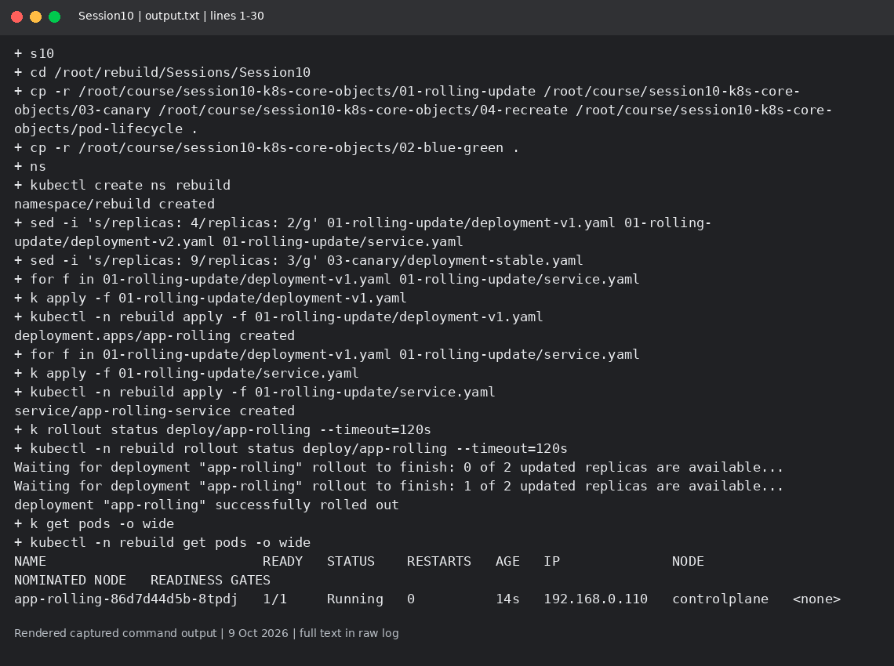
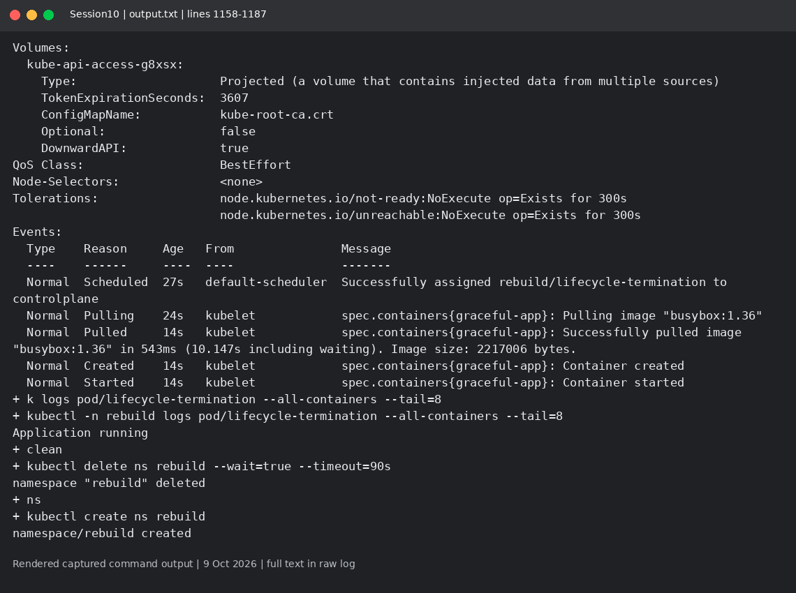
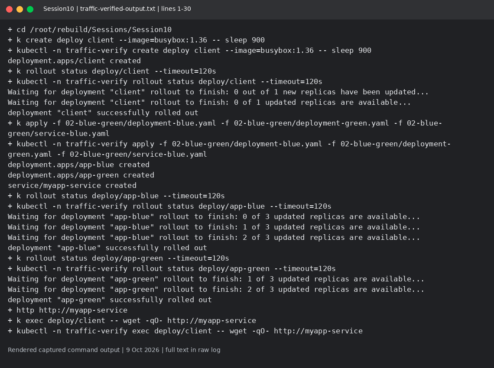
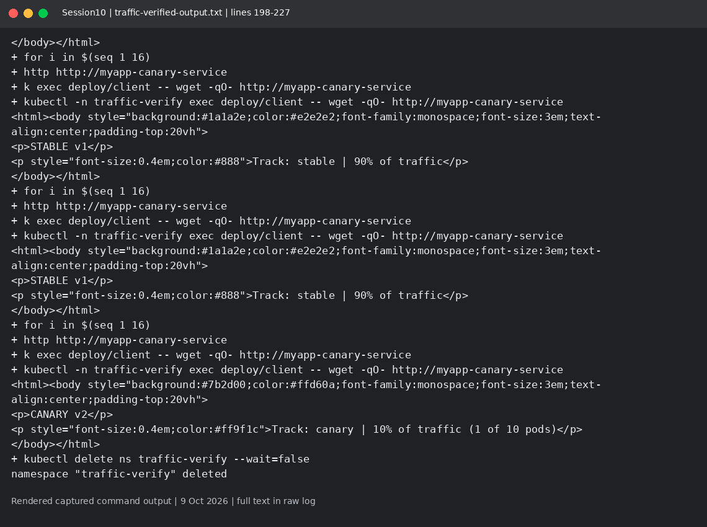

# Session 10: Deployments and Pod lifecycle

Mohd Jahur | Enrollment 10319

## Work and observations

1. I applied the rolling, blue-green, canary and Recreate manifests and captured rollout, Pod and ReplicaSet output. The extra traffic log checks blue/green and canary HTTP responses.
2. I applied the lifecycle examples and inspected status, events and logs. Rolling uses 2 replicas; canary uses 3 stable plus 1 canary to fit the free lab. Replica ratio is an approximate routing share, not an exact measured guarantee.

## Evidence

Fresh run on 9 October 2026 in a separate disposable lab. These are rendered views of actual captured command output, not live terminal screenshots. Raw logs are included so the text can be checked.

<!-- EVIDENCE -->

The upstream canary HTML still says 90%/10% in the captured page. This small-lab run actually used 3 stable Pods and 1 canary Pod, so the nominal count ratio was 75%/25%. The page label is stale; HTTP samples only establish that both versions were reached.

## Captured output files

- [output.txt](output.txt)
- [traffic-verified-output.txt](traffic-verified-output.txt)

