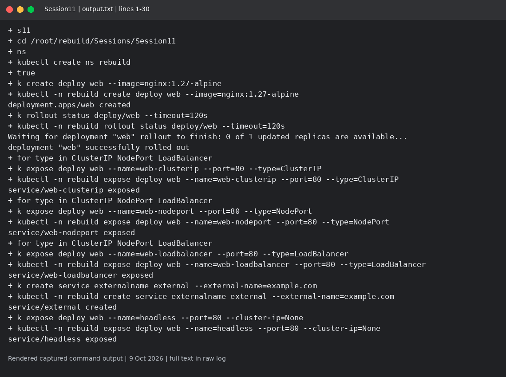
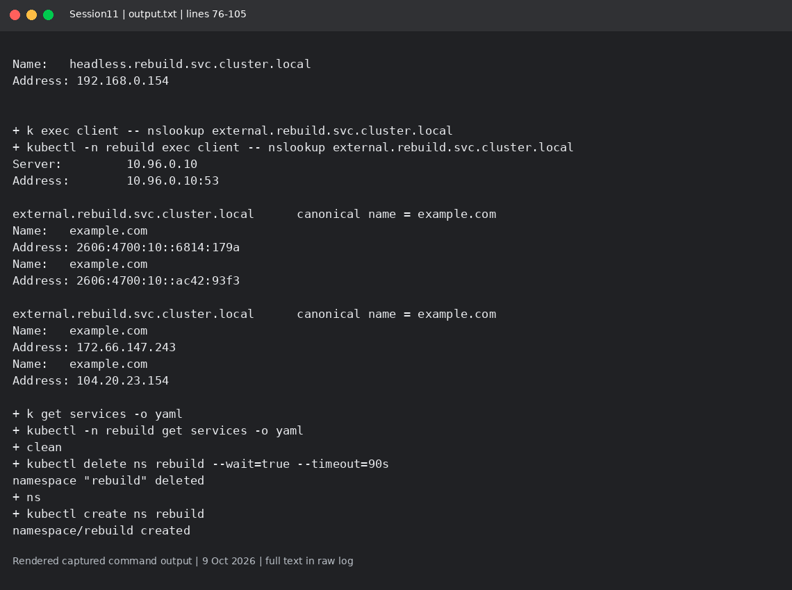

# Session 11: Kubernetes Services

Mohd Jahur | Enrollment 10319

## Work and observations

1. I created ClusterIP, NodePort, LoadBalancer, ExternalName and headless Services, then captured their state and DNS/connectivity checks.
2. A Deployment manages ReplicaSets and rolling updates; a ReplicaSet keeps a replica count; a Service provides discovery and traffic routing. This local lab has no cloud LoadBalancer, so its external address can stay pending.

## Evidence

Fresh run on 9 October 2026 in a separate disposable lab. These are rendered views of actual captured command output, not live terminal screenshots. Raw logs are included so the text can be checked.

<!-- EVIDENCE -->

## References

- https://kubernetes.io/docs/concepts/services-networking/service/
- https://kubernetes.io/docs/concepts/workloads/controllers/deployment/
- https://kubernetes.io/docs/concepts/services-networking/dns-pod-service/

## Object comparison

| Object | Purpose | Scaling and update | Networking/storage example |
| --- | --- | --- | --- |
| Deployment | Stateless application Pods through ReplicaSets | Change replicas; manages rolling updates | Web API; Pods are replaceable behind a Service |
| ReplicaSet | Maintain a requested Pod count | Change replicas; no Deployment-style update strategy | Usually owned by a Deployment |
| DaemonSet | One Pod per eligible node | Follows node count and placement | Logging agent or node networking |
| StatefulSet | Pods with stable ordinal identity | Ordered management by default | Database with stable DNS and per-Pod PVCs |
| Service | Stable discovery and routing to endpoints | Does not create or scale Pods | Client -> Service -> matching ready Pod |

A ReplicaSet cannot replace a Service: keeping Pods alive does not provide a stable endpoint when those Pods are replaced.

Sources: https://kubernetes.io/docs/concepts/workloads/controllers/daemonset/ and https://kubernetes.io/docs/concepts/workloads/controllers/statefulset/

## Captured output files

- [output.txt](output.txt)

