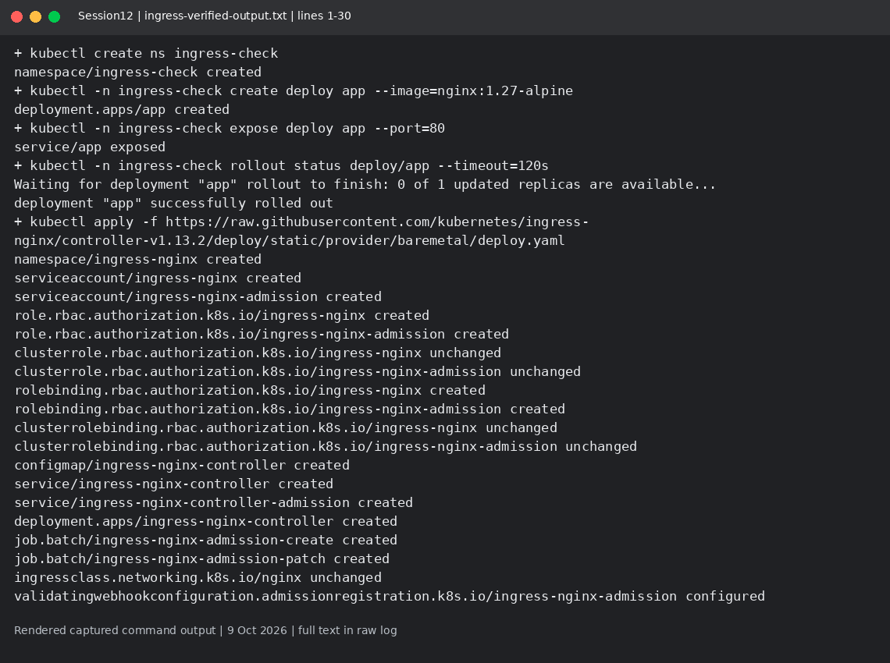
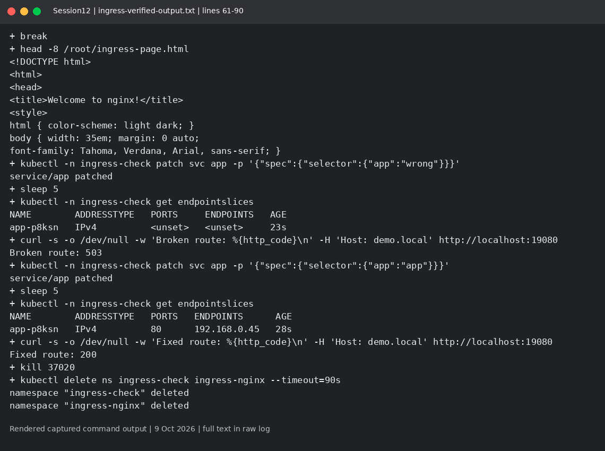
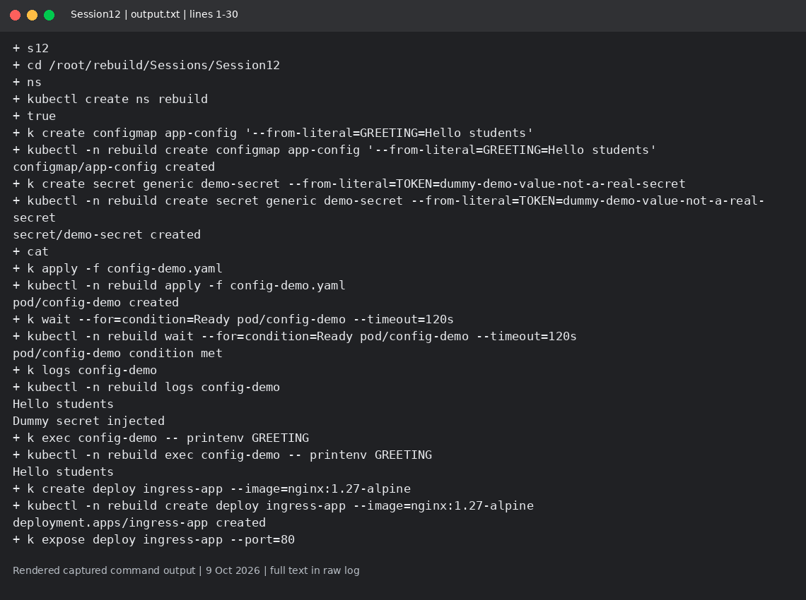
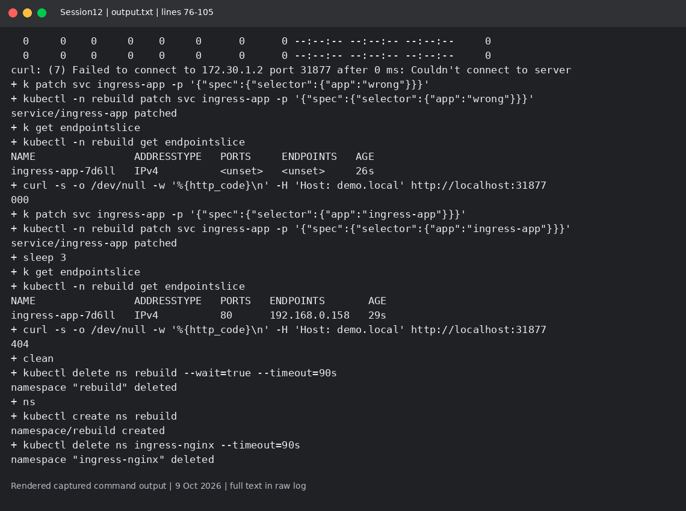

# Session 12: ConfigMaps, Secrets and Ingress

Mohd Jahur | Enrollment 10319

## Work and observations

1. I injected a ConfigMap and a dummy Secret into a Pod and checked the values through logs and exec. No real credentials were used.
2. I installed an Ingress controller, applied a host rule, and tested routing. I broke the backend Service selector, inspected endpoints and HTTP status, then restored the selector. An Ingress is configuration; the controller implements it.

## Evidence

Fresh run on 9 October 2026 in a separate disposable lab. These are rendered views of actual captured command output, not live terminal screenshots. Raw logs are included so the text can be checked.

<!-- EVIDENCE -->

## Correction
The first Ingress apply failed while the admission service was starting. ingress-verified-output.txt is the corrected run: the route returned 200, an intentionally broken Service selector returned 503, and the fixed route returned 200. The transient missing admission Jobs are retained in the log; successful routing is established by the later HTTP checks.

## References

- https://kubernetes.io/docs/concepts/configuration/secret/

Sources: https://kubernetes.io/docs/concepts/services-networking/ingress/

## Captured output files

- [ingress-verified-output.txt](ingress-verified-output.txt)
- [output.txt](output.txt)

