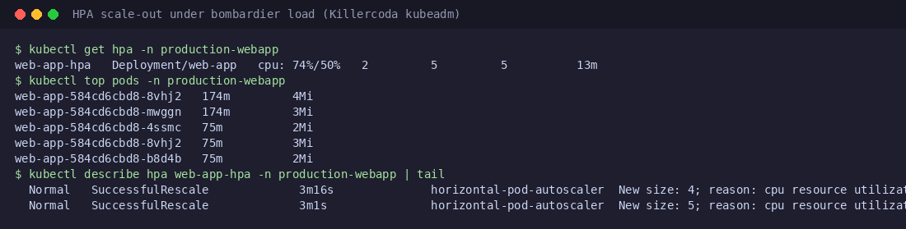
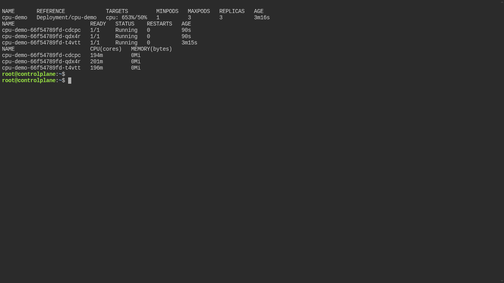
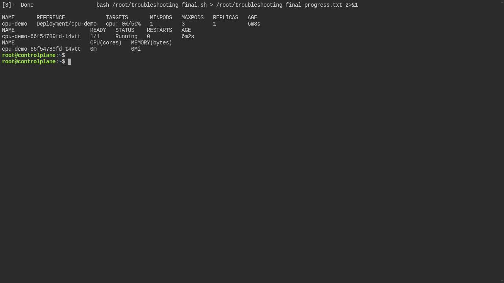
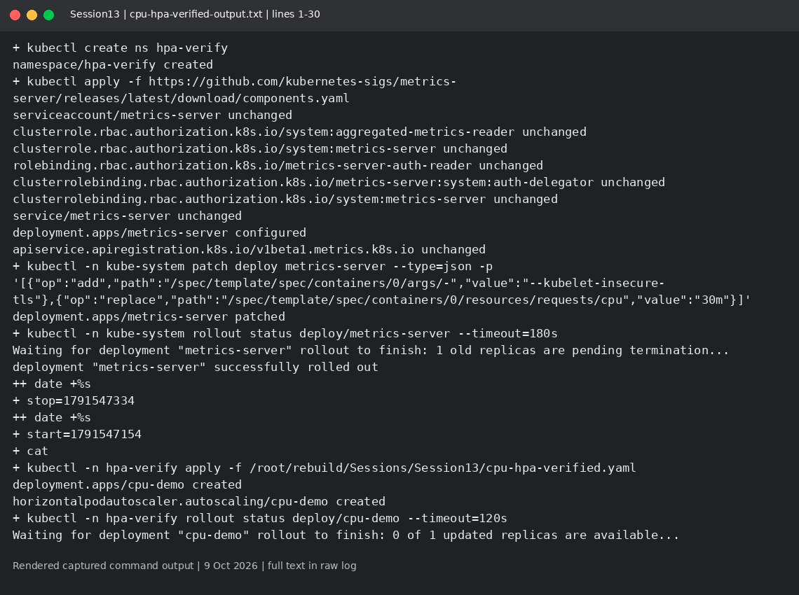
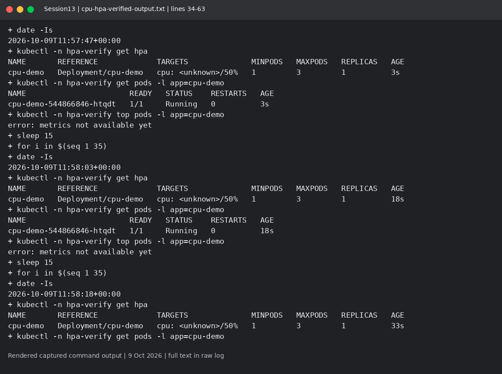
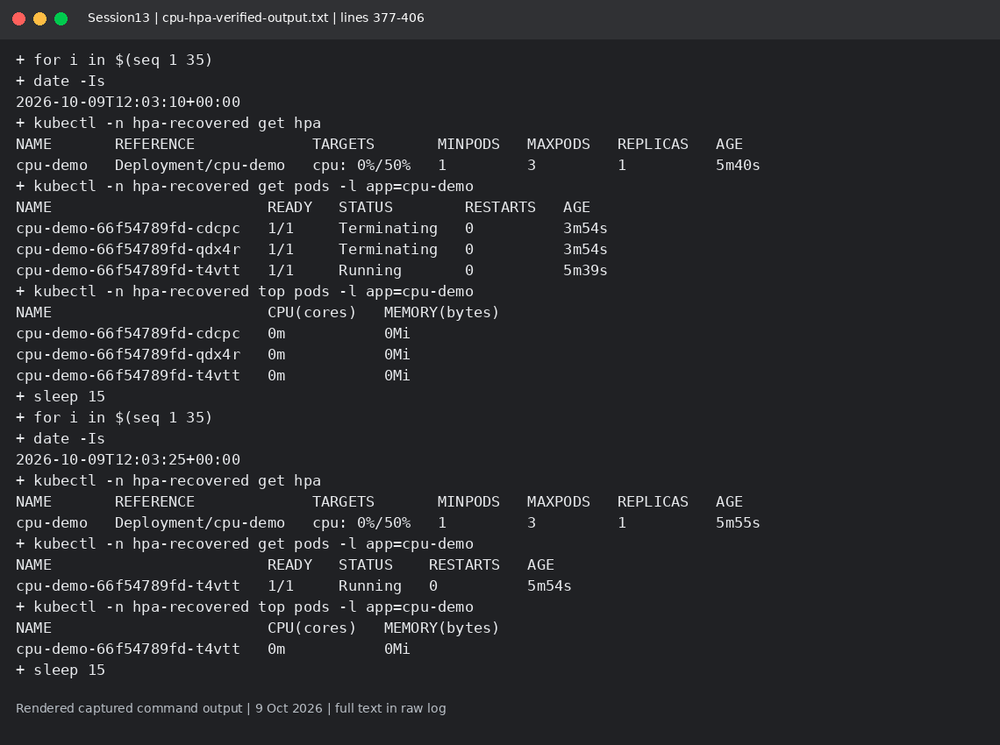

# Session 13: Storage and CPU HPA

Mohd Jahur | Enrollment 10319

## Work and observations

1. This is a separate bounded CPU HPA demonstration, not the course HTTP traffic exercise. See the actual HPA samples before treating scaling as verified.
2. The lab configuration uses 30m CPU requests, a 200m limit, maximum 3 replicas, and a 30-second scale-down stabilization window. Metrics-server uses an insecure kubelet TLS flag only for this disposable lab. The course mini-project is now done - see the update section below.

## Evidence

Fresh run on 9 October 2026 in a separate disposable lab. These are rendered views of actual captured command output, not live terminal screenshots. Raw logs are included so the text can be checked.

<!-- EVIDENCE -->

## Update, 18 October 2026: mini-project completed

The full mini-project ran on a real Kubernetes cluster (Killercoda kubeadm playground, 2 nodes, v1.37.1): emptyDir/hostPath volumes, static PV+PVC, dynamic local-path provisioning, the course web app deployed with PVC, liveness/readiness probes and an HPA (min 2, max 5, 50% CPU). The persistence test wrote `Student: Mohd Jahur, Enrollment 10319` into the volume, deleted the pod and read the same data back from the new pod - persistence confirmed. A real bombardier load test (500 connections, 4 minutes) scaled the deployment from 2 to 5 replicas at 74%/50% CPU.

Full write-up and evidence: [`session-13-storage-hpa-probes/mini-project/`](../../session-13-storage-hpa-probes/mini-project/) (complete log: [`evidence/s13-evidence-full.log`](../../session-13-storage-hpa-probes/mini-project/evidence/s13-evidence-full.log)).

## References

- https://kubernetes.io/docs/concepts/storage/volumes/

The first attempt changed desired HPA replicas 1 -> 3 -> 1, but two new Pods stayed Pending under disk pressure. This is autoscaler-decision evidence, not proof that three workload Pods ran. A recovered-run log, if present, must separately show all three Running.

Sources: https://kubernetes.io/docs/concepts/workloads/autoscaling/horizontal-pod-autoscale/

This image is an actual browser terminal capture of scale-up. Other terminal-window images in the package are rendered from raw logs.

## Verified recovered result
The recovered run shows HPA and Running workload Pods scaling 1 -> 3 -> 1. cpu-hpa-verified-output.txt records the samples. The earlier disk-pressure-attempt.txt is a separate failed workload attempt, not the proof used for this result. All replicas share a common epoch cutoff for CPU work, so the load really ends across the whole Deployment.

## Captured output files

- [cpu-hpa-verified-output.txt](cpu-hpa-verified-output.txt)
- [disk-pressure-attempt.txt](disk-pressure-attempt.txt)
- [output.txt](output.txt)

