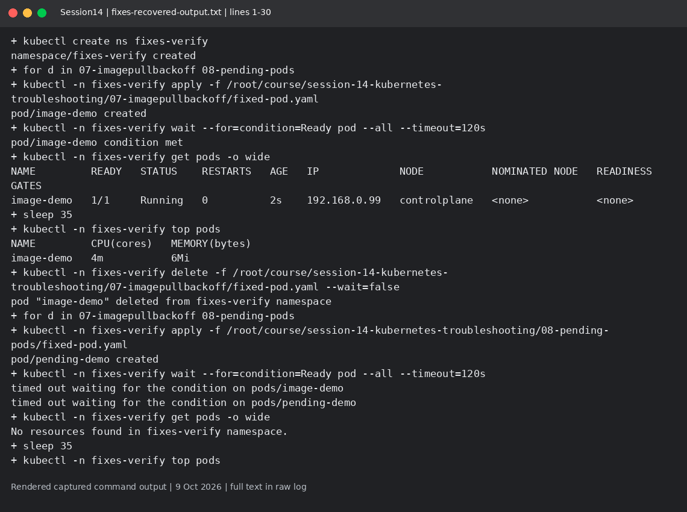
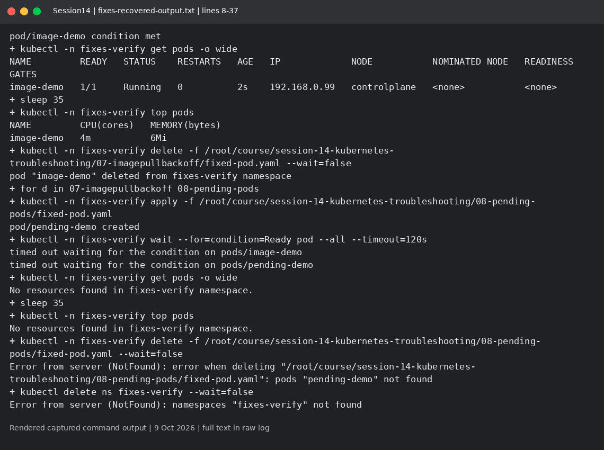
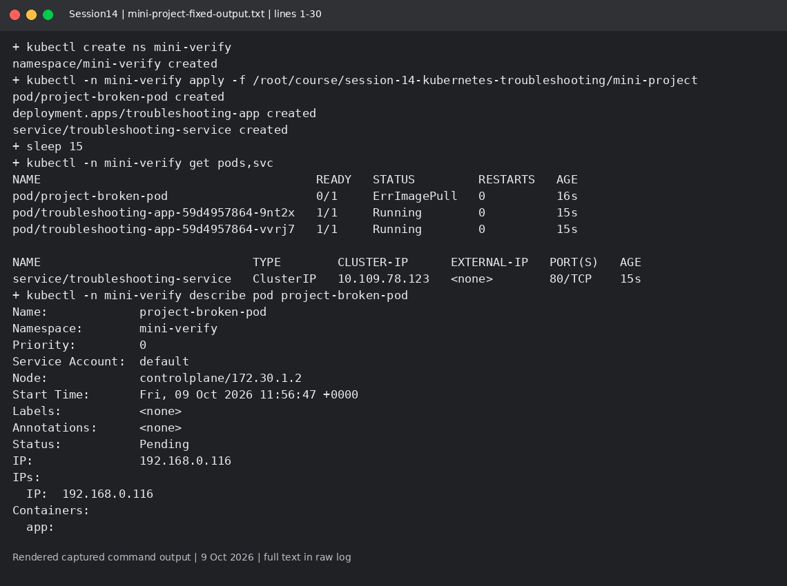
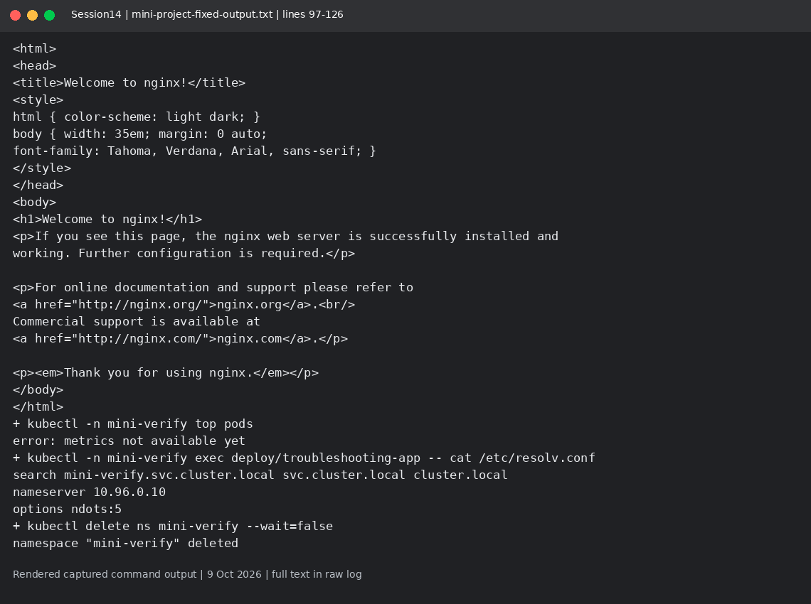
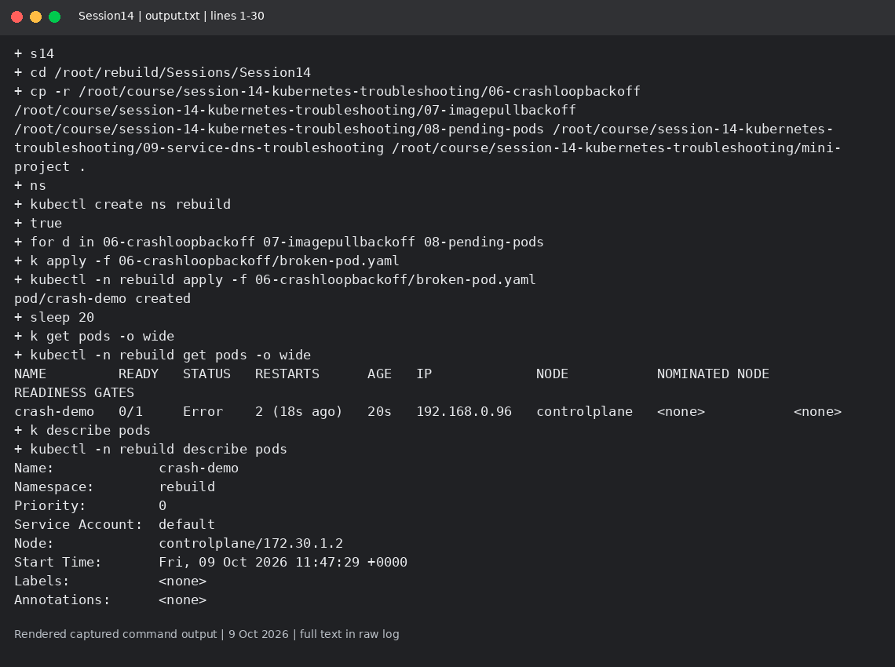
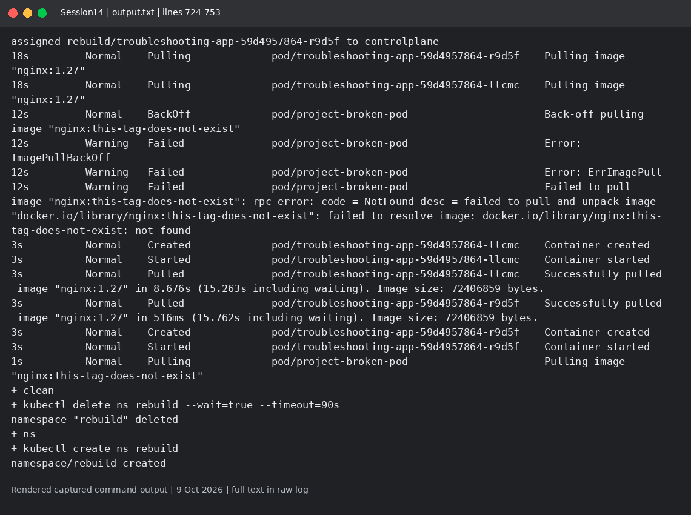
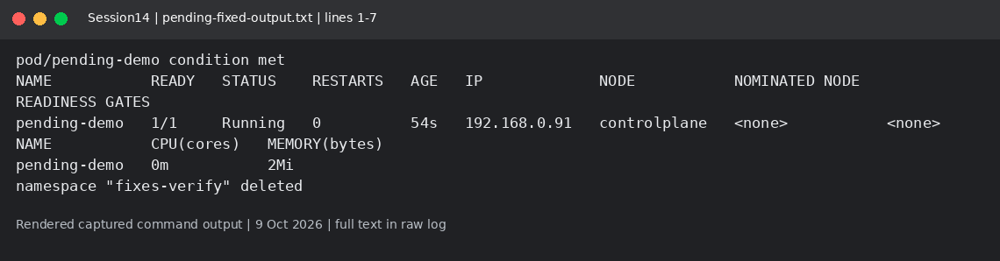

# Session 14: Kubernetes troubleshooting

Mohd Jahur | Enrollment 10319

## Work and observations

1. I practiced get, describe, logs, exec, events, explain, top and wide output while inspecting intentional failures.
2. Broken and fixed manifests, before/after logs and investigation output are included. Any unfinished failure or mini-project step is called out below; a command returning zero is not by itself proof of completion.

## Evidence

Fresh run on 9 October 2026 in a separate disposable lab. These are rendered views of actual captured command output, not live terminal screenshots. Raw logs are included so the text can be checked.

<!-- EVIDENCE -->

mini-project-fixed-output.txt records the invalid-image mini-project Pod changed to nginx:1.27-alpine and its Ready condition, followed by a successful HTTP check through troubleshooting-service. The top command initially returned "metrics not available yet" for these new Pods; no success is claimed for that sample.

The first image/pending fixes did not reach Ready while the node had disk pressure. After recovery, pending-fixed-output.txt and fixes-recovered-output.txt record both corrected Pods Running with CPU/memory samples; the corrected mini-project also reached Ready. This rebuild does not claim a separate successful fix for every possible DNS, Pod-networking or ContainerCreating failure.

After disk recovery, fixes-recovered-output.txt separately verifies the corrected image and resource-request Pods becoming Ready. Initial metrics samples for new Pods may still be missing; the successful Session13 top output establishes the metrics pipeline separately.

## Captured output files

- [fixes-recovered-output.txt](fixes-recovered-output.txt)
- [mini-project-fixed-output.txt](mini-project-fixed-output.txt)
- [output.txt](output.txt)
- [pending-fixed-output.txt](pending-fixed-output.txt)

