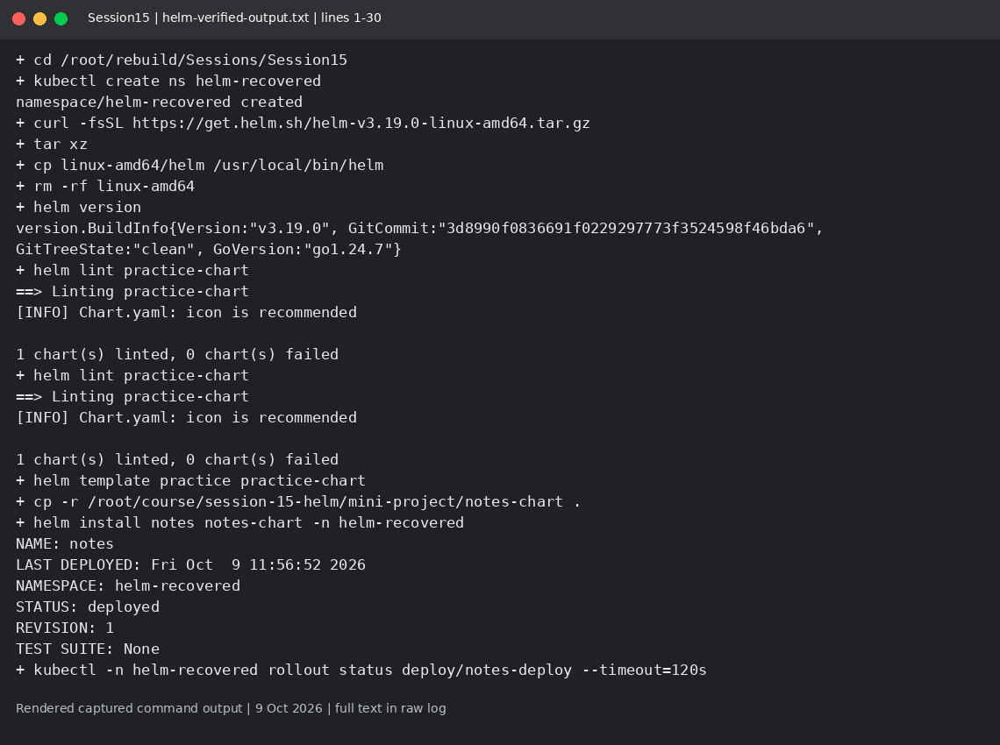
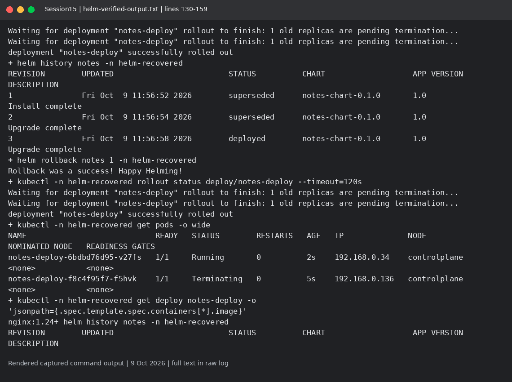
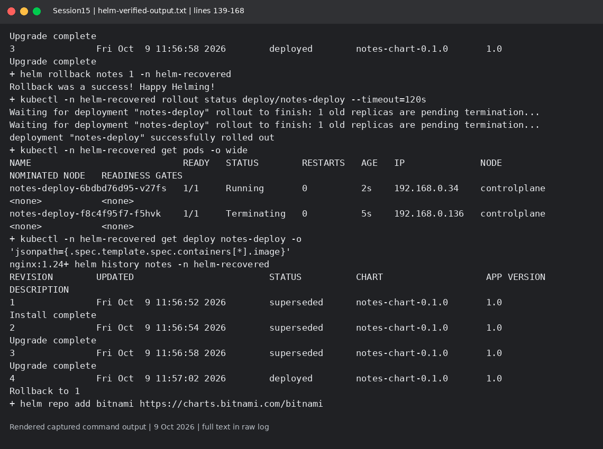
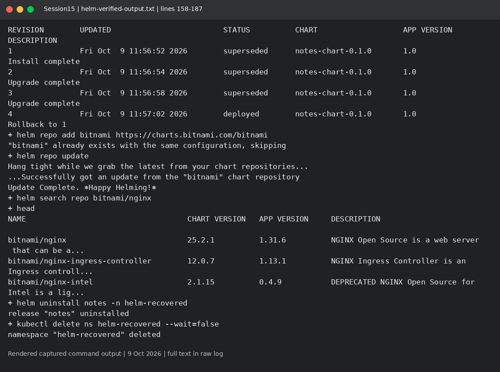

# Session 15: Helm commands and rollback

Mohd Jahur | Enrollment 10319

## Work and observations

1. I practiced create, lint, template, install, list, status, get, upgrade, history, rollback, repo/search and uninstall.
2. The Notes chart is from the course and is an Nginx demonstration, not an implemented Notes backend. The log records the two upgrades, rollback and final state.

## Evidence

Fresh run on 9 October 2026 in a separate disposable lab. These are rendered views of actual captured command output, not live terminal screenshots. Raw logs are included so the text can be checked.

<!-- EVIDENCE -->

## Limit of this run
helm-disk-pressure-attempt.txt preserves the first failed rollouts. The recovered helm-verified-output.txt is a fresh full run after disk pressure cleared; it records successful install, both upgrade rollouts, rollback to revision1/nginx:1.24, and cleanup.

## Captured output files

- [helm-disk-pressure-attempt.txt](helm-disk-pressure-attempt.txt)
- [helm-verified-output.txt](helm-verified-output.txt)
- [output.txt](output.txt)

