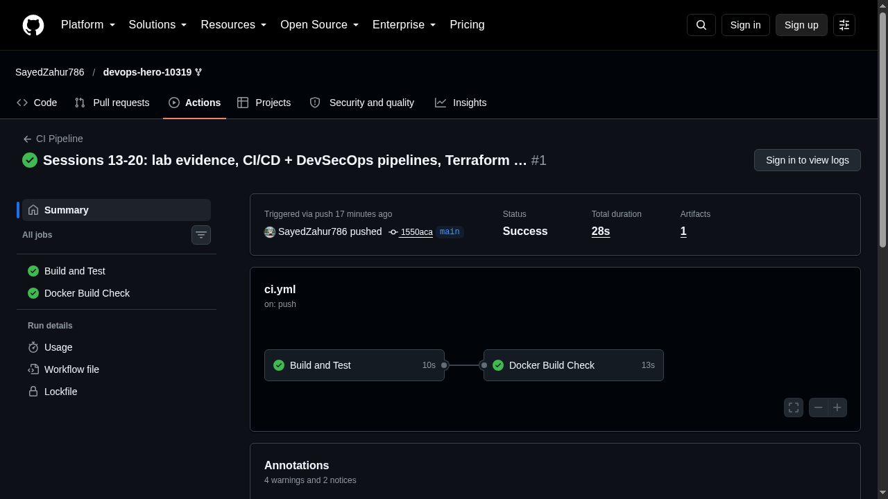
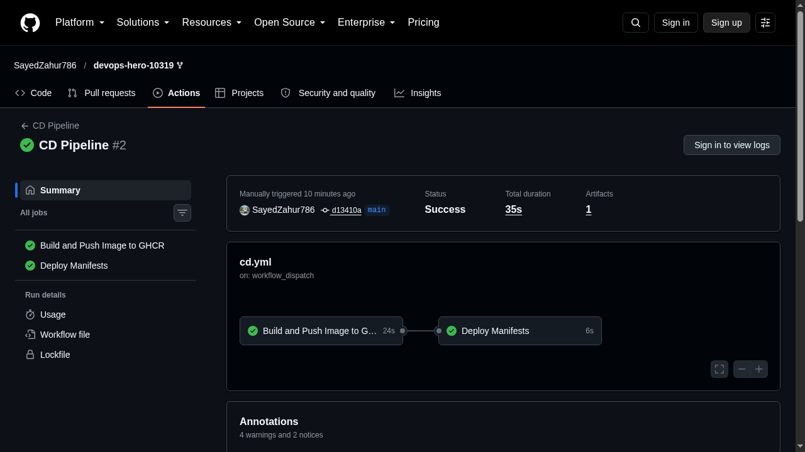

# Session 16: GitHub Actions CI/CD Pipeline

Mohd Jahur | Enrollment 10319

## Work and observations

I built the final CI/CD pipeline project: a small Flask application with a full GitHub Actions pipeline. The full project lives in [`session-16-github-actions/final-cicd-pipeline/`](../../session-16-github-actions/final-cicd-pipeline/).

1. `app/` - Flask app (the same app I containerized in Session 17), with a pytest suite. 8/8 tests pass.
2. `Dockerfile` - container image build for the app.
3. `.github/workflows/ci.yml` - on every push/PR: install deps, run flake8 lint, run pytest, build the Docker image.
4. `.github/workflows/cd.yml` - on push to main: build and push the image to GHCR (`ghcr.io/sayedzahur786/devops-hero-10319/session16-app`).
5. `k8s/` - deployment manifests for the built image.

Fixed during the real runs: GHCR rejects uppercase repository owners, so image tags use the lowercase `sayedzahur786` path.

## GitHub Actions run evidence (real runs on this repo)

- CI Pipeline: SUCCESS - lint, 8/8 tests, docker build: https://github.com/SayedZahur786/devops-hero-10319/actions/runs/39072826847 (re-ran green: https://github.com/SayedZahur786/devops-hero-10319/actions/runs/39074046933)
- CD Pipeline: SUCCESS - image built and pushed to GHCR, deploy manifests rendered: https://github.com/SayedZahur786/devops-hero-10319/actions/runs/39073262938 (re-ran green: https://github.com/SayedZahur786/devops-hero-10319/actions/runs/39074080936)

## Captured output files

| Path | Contents |
|------|----------|
| [`session-16-github-actions/final-cicd-pipeline/`](../../session-16-github-actions/final-cicd-pipeline/) | App, tests, Dockerfile, workflows, k8s manifests, README |
| `.github/workflows/ci.yml`, `.github/workflows/cd.yml` | The live workflows GitHub runs (repo root) |
