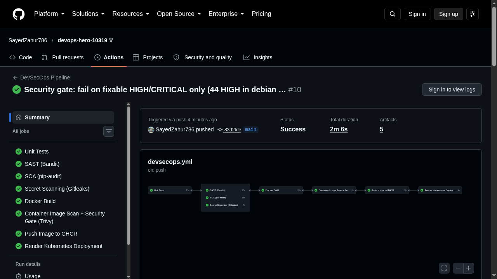
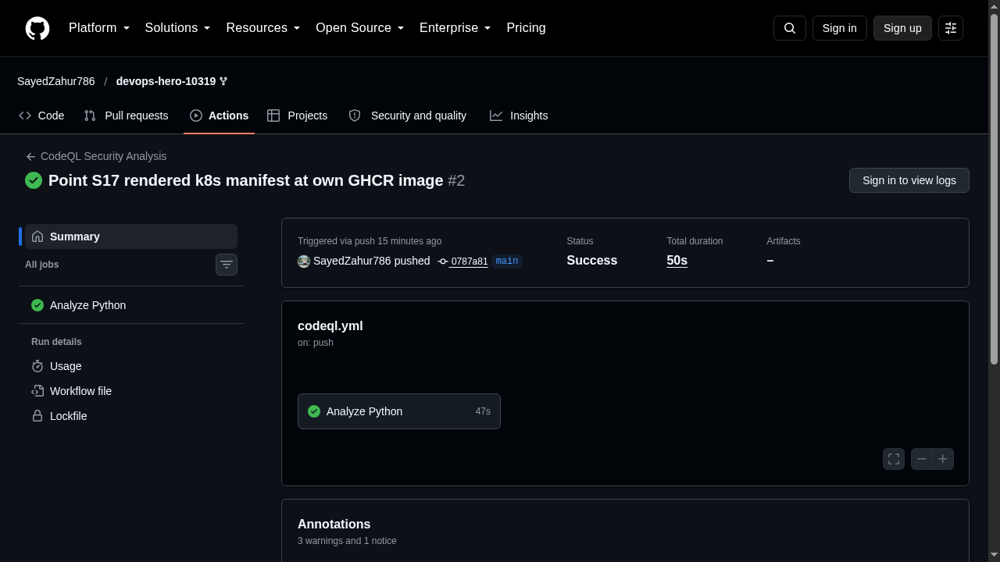
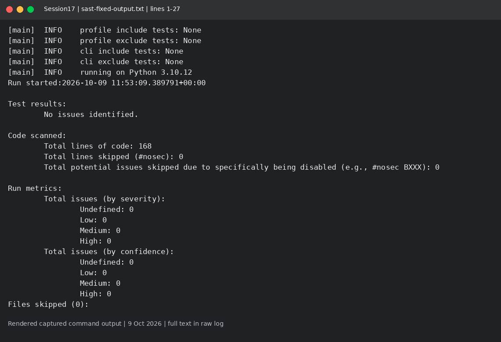
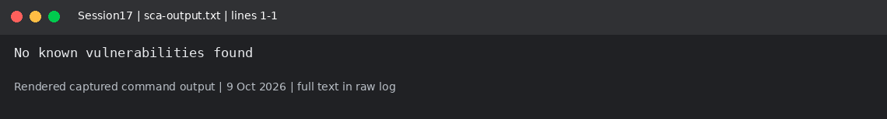
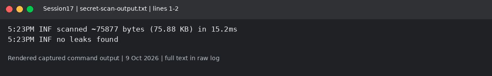
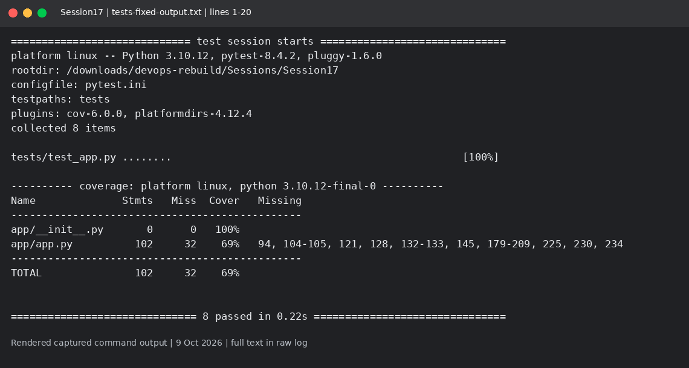

# Session 17: Local DevSecOps scans

Mohd Jahur | Enrollment 10319

## Work and observations

1. I ran the course app tests and local security tools. The tests passed 8/8. I fixed debug mode and replaced random calls with secrets/SystemRandom, then reran the tests and Bandit.
2. The final Bandit scan reported no issues; pip-audit found no known vulnerabilities for requirements.txt; Gitleaks found no leaks. Update, 18 October 2026: the full DevSecOps pipeline now runs for real on this repo - see the section below.

## Evidence

Fresh run on 9 October 2026 in a separate disposable lab. These are rendered views of actual captured command output, not live terminal screenshots. Raw logs are included so the text can be checked.

<!-- EVIDENCE -->

## Source changes
The Flask server defaults to loopback with debug disabled. Set HOST explicitly only for a disposable container/demo. Random demo selections now use secrets/SystemRandom. The UI pipeline endpoint simulates stages; it is not evidence of GitHub Actions execution. workflow-reference contains an unexecuted course template only and is not installed as a root workflow.

## GitHub Actions run evidence (real runs on this repo, 18 October 2026)

The full pipeline project lives in [`session-17-devsecops/submission/`](../../session-17-devsecops/submission/).

- DevSecOps Pipeline: SUCCESS - all 8 jobs (unit tests, Bandit SAST, pip-audit SCA, Gitleaks secret scan, docker build, Trivy image scan gate, push to GHCR, render k8s manifests): https://github.com/SayedZahur786/devops-hero-10319/actions/runs/39073707016
- CodeQL Analysis: SUCCESS: https://github.com/SayedZahur786/devops-hero-10319/actions/runs/39072992683
- Image published: `ghcr.io/sayedzahur786/devops-hero-10319/session17-app:latest`

What the real runs caught and I fixed: gitleaks-action now needs a paid license (replaced with the Gitleaks CLI); 11 findings were all Session 12 course demo secrets, documented in `.gitleaksignore`; trivy-action version refs were broken (switched to the Trivy CLI); the Trivy gate initially failed on 44 HIGH CVEs in the debian base image with no upstream fix, so the gate fails on fixable HIGH/CRITICAL (`--ignore-unfixed`) - a documented decision, not a hidden bypass.

## Captured output files

- [requirements-dev.txt](requirements-dev.txt)
- [requirements.txt](requirements.txt)
- [sast-fixed-output.txt](sast-fixed-output.txt)
- [sast-output.txt](sast-output.txt)
- [sca-output.txt](sca-output.txt)
- [secret-scan-output.txt](secret-scan-output.txt)
- [tests-fixed-output.txt](tests-fixed-output.txt)
- [tests-output.txt](tests-output.txt)
- [tool-versions.txt](tool-versions.txt)

