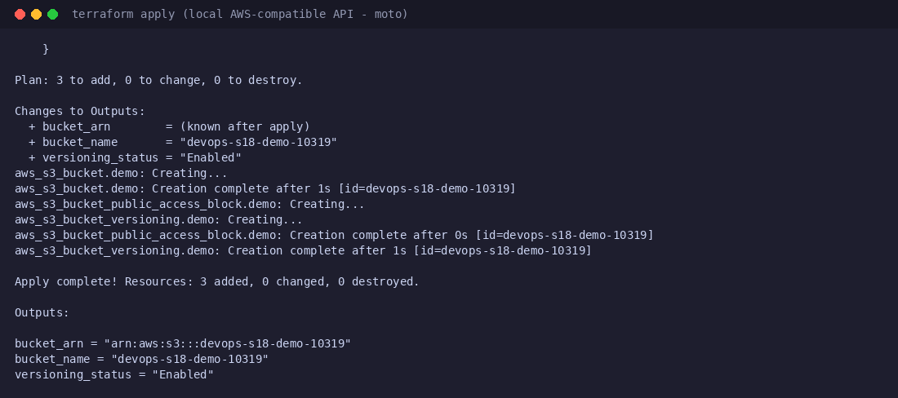

# Session 18: Terraform IaC

Mohd Jahur | Enrollment 10319

## Work and observations

**Task 1 - terraform-s3-demo:** I ran the full Terraform workflow for real: `init`, `fmt`, `validate`, `plan`, `apply` (3 resources added: S3 bucket, versioning, public-access block), `show`, `output`, and `destroy`. Every command's output is captured in [`session18-terraform-iac/terraform-s3-demo/logs/`](../../session18-terraform-iac/terraform-s3-demo/logs/).

Honest note: I do not have an AWS account for this course, so the provider was pointed at a local AWS-compatible API (moto) via `terraform-s3-demo/local_override.tf`. The Terraform workflow, state handling, plan/apply cycle and outputs are real; the API endpoint is local, not AWS.

**Task 2 - aws-services:** written documentation of five core AWS services with use cases and how they relate: [`session18-terraform-iac/aws-services/`](../../session18-terraform-iac/) (01-iam to 05-dynamodb-rds).

## Captured output files

| Path | Contents |
|------|----------|
| [`session18-terraform-iac/terraform-s3-demo/`](../../session18-terraform-iac/terraform-s3-demo/) | Full Terraform project + per-step logs (01-init to 08-destroy) |
| [`session18-terraform-iac/aws-services/`](../../session18-terraform-iac/) | Task 2 documentation of five AWS services |
