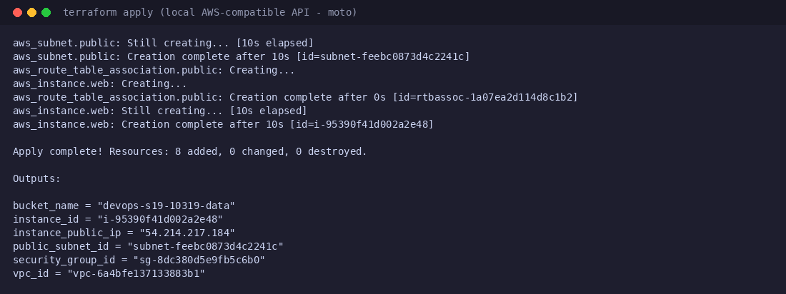

# Session 19: Cloud + Terraform - AWS Infrastructure

Mohd Jahur | Enrollment 10319

## Work and observations

I defined a small but real AWS architecture in Terraform and ran the full workflow: VPC, public subnet, internet gateway, route table + association, security group, EC2 instance and an S3 bucket - 8 resources added in `apply`, verified with `show`/`output`, then destroyed. Logs for every step are in [`session19-cloud-terraform/terraform-aws-infra/logs/`](../../session19-cloud-terraform/terraform-aws-infra/logs/).

Same honest note as Session 18: without an AWS account I ran the provider against a local AWS-compatible API (moto) using `terraform-aws-infra/local_override.tf`. The Terraform code, dependency graph, plan/apply and destroy are real runs; the endpoint is local. The code is standard AWS provider code and would apply unchanged against a real account (minus the override file).

## Captured output files

| Path | Contents |
|------|----------|
| [`session19-cloud-terraform/terraform-aws-infra/`](../../session19-cloud-terraform/terraform-aws-infra/) | Full Terraform project + per-step logs (01-init to 08-destroy) |
