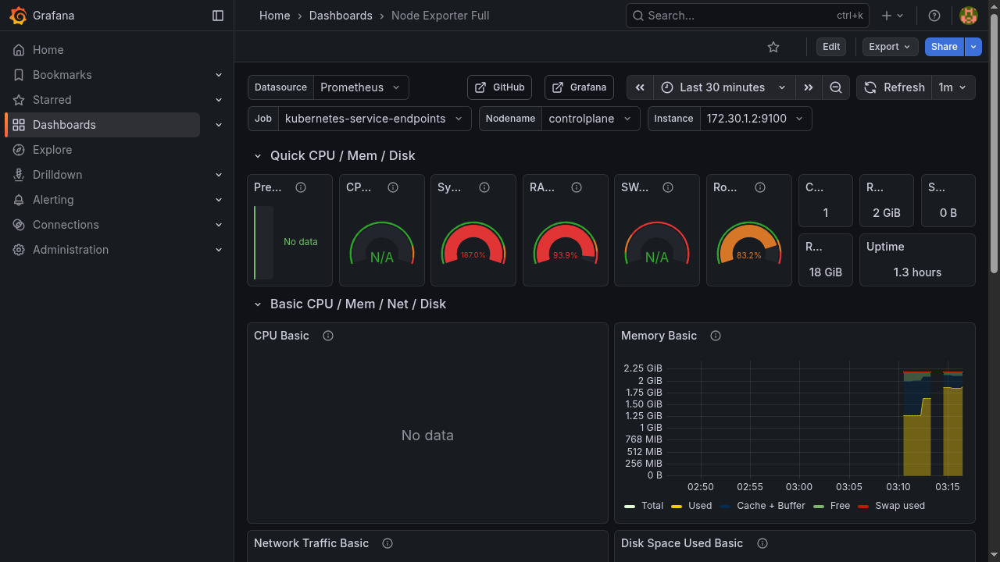
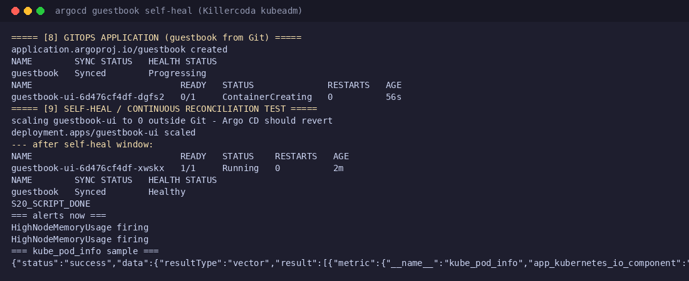

# Session 20: Monitoring, Observability and GitOps

Mohd Jahur | Enrollment 10319

## Work and observations

All of this ran on a real Kubernetes cluster (Killercoda kubeadm playground, 2 nodes, v1.37.1). Full write-up: [`session20-monitoring-observability-gitops/mini-project/`](../../session20-monitoring-observability-gitops/mini-project/).

**Prometheus + Alertmanager (Helm):** installed the `prometheus-community/prometheus` stack (server, alertmanager, kube-state-metrics, node-exporter, pushgateway - all pods Running), ran real PromQL queries through the HTTP API, and created a PrometheusRule `HighNodeMemoryUsage`, captured first as `pending` and later as `firing`.

**Grafana (Helm):** installed Grafana, imported dashboard 1860 (Node Exporter Full) via the UI and captured a real screenshot of live node data.

**ArgoCD (GitOps):** installed Argo CD, created a `guestbook` Application that reached `Synced / Healthy`, then ran a self-heal test: scaled `guestbook-ui` to 0 outside Git and Argo CD detected the drift and reverted it to 1/1 Running.

Note: the ArgoCD UI was reachable only through kubectl port-forward on the ephemeral lab, so UI screenshots were not kept; the CLI status output is captured in full in the evidence log.

## Captured output files

| Path | Contents |
|------|----------|
| [`evidence/s20-full.log`](../../session20-monitoring-observability-gitops/mini-project/evidence/s20-full.log) | Complete captured output: installs, PromQL results, alerts, guestbook sync, self-heal revert |
| [`mini-project/docs/`](../../session20-monitoring-observability-gitops/mini-project/docs/) | Written notes on observability pillars and GitOps principles |
