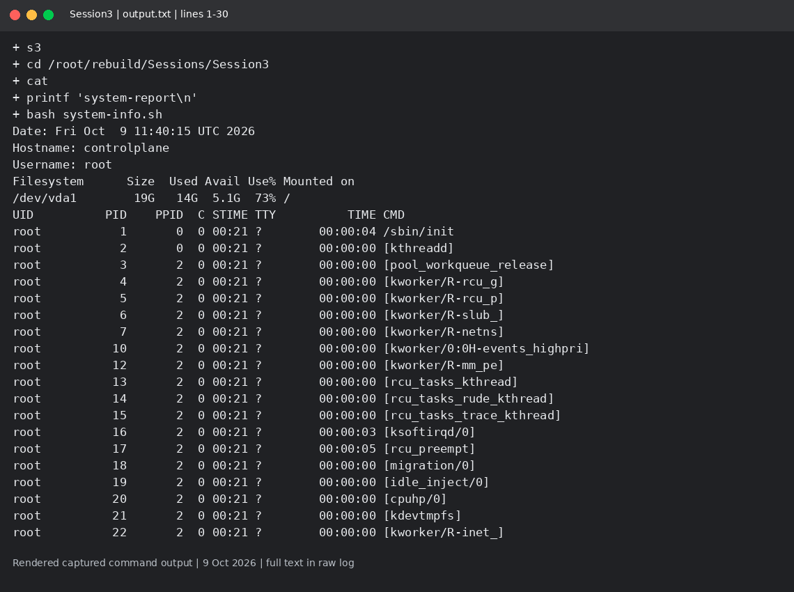
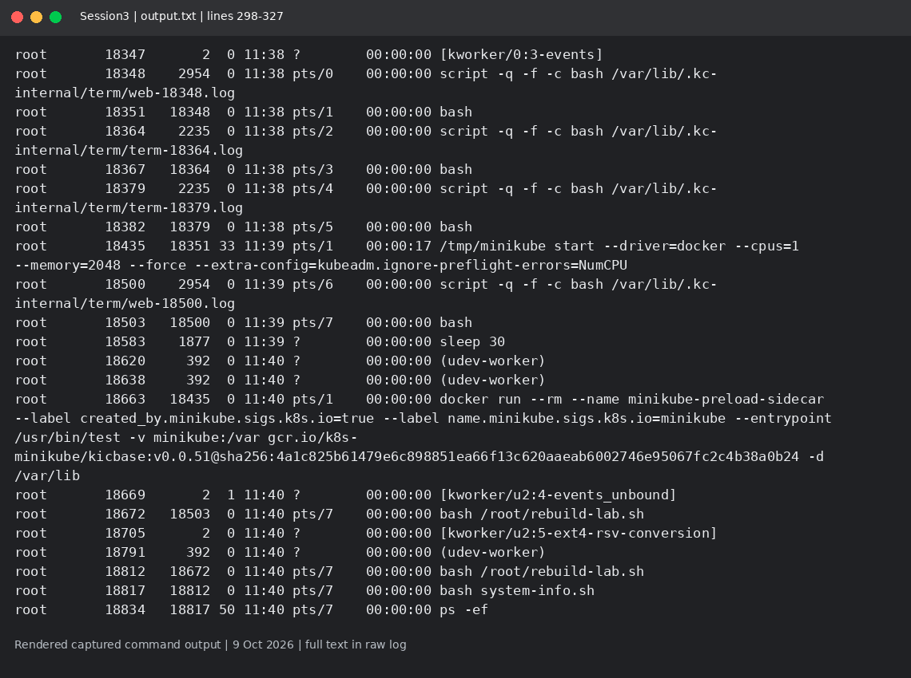

# Session 3: System information script

Mohd Jahur | Enrollment 10319

## Work and observations

1. I wrote system-info.sh with variables, read -p, mkdir, touch, df and ps output redirection.
2. The run created system-report/processes.txt and printed the actual lab date, hostname, username, disk usage and process list.

## Evidence

Fresh run on 9 October 2026 in a separate disposable lab. These are rendered views of actual captured command output, not live terminal screenshots. Raw logs are included so the text can be checked.

<!-- EVIDENCE -->

## Captured output files

- [output.txt](output.txt)

