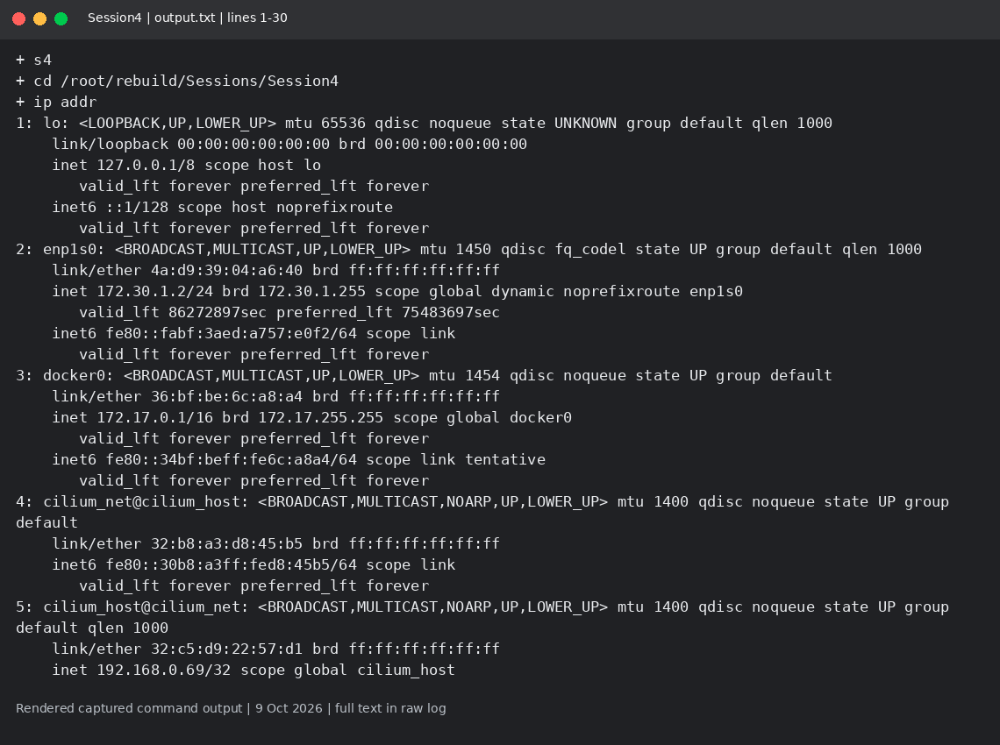
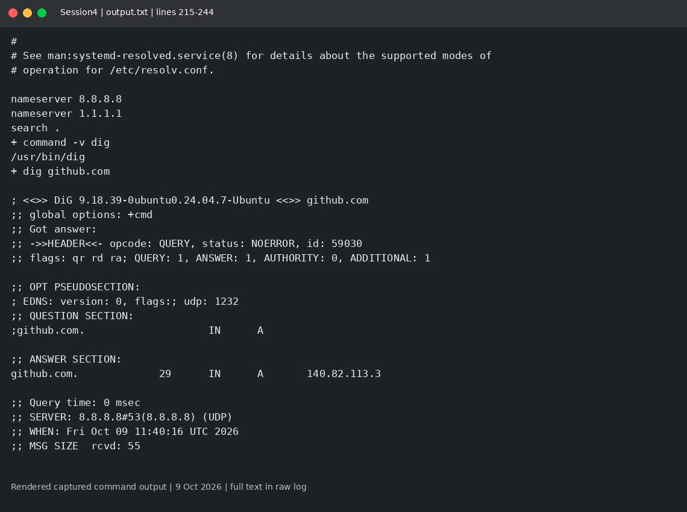

# Session 4: Networking fundamentals

Mohd Jahur | Enrollment 10319

## Work and observations

1. I checked interfaces, routes, listening sockets, loopback reachability, DNS and HTTPS response headers.
2. ip shows interface addressing; ip route shows the next hop; ss shows listening ports; ping tests ICMP; dig/getent resolve names; curl checks the HTTP response.

## Evidence

Fresh run on 9 October 2026 in a separate disposable lab. These are rendered views of actual captured command output, not live terminal screenshots. Raw logs are included so the text can be checked.

<!-- EVIDENCE -->

## Captured output files

- [output.txt](output.txt)

