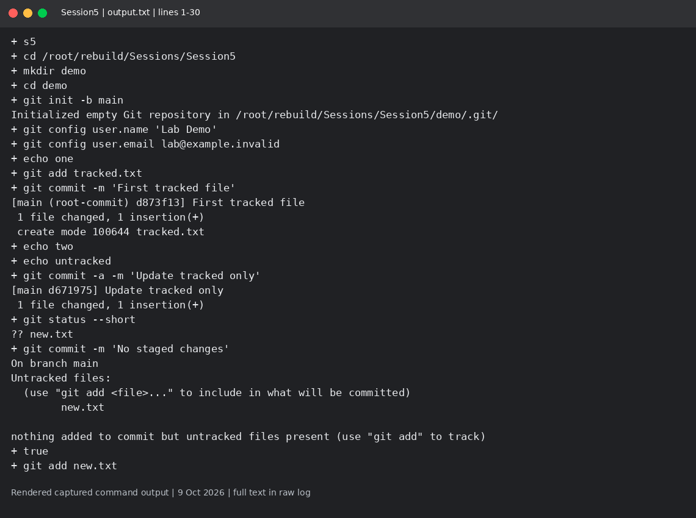
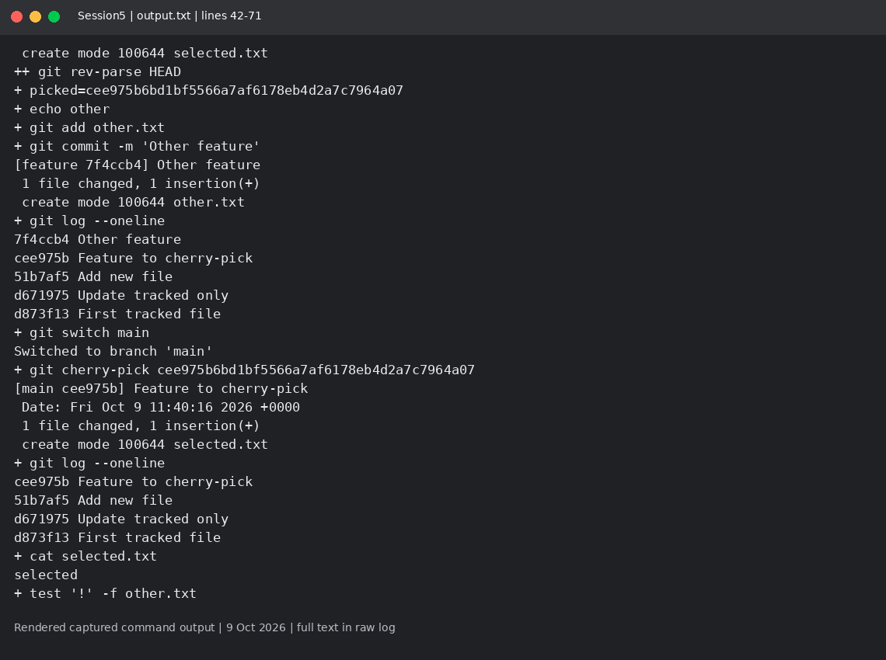

# Session 5: Git and cherry-pick

Mohd Jahur | Enrollment 10319

## Work and observations

1. I tested git commit -a -m: it committed tracked changes but left new.txt untracked. git commit -m without staged changes did not create a commit.
2. I made commits on main and feature, cherry-picked only the selected feature commit, then checked that selected.txt existed and other.txt did not.

## Evidence

Fresh run on 9 October 2026 in a separate disposable lab. These are rendered views of actual captured command output, not live terminal screenshots. Raw logs are included so the text can be checked.

<!-- EVIDENCE -->

## Captured output files

- [output.txt](output.txt)

