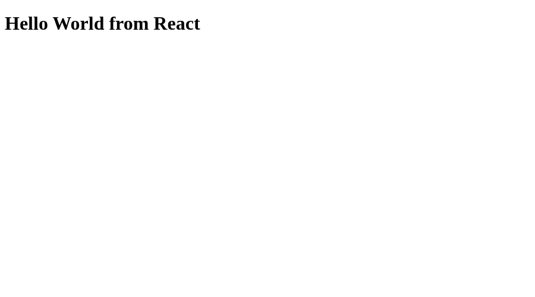
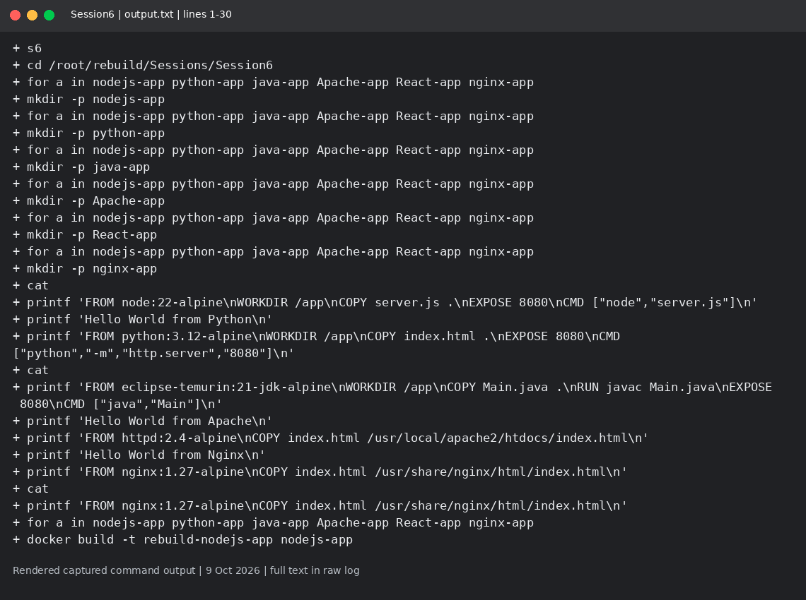
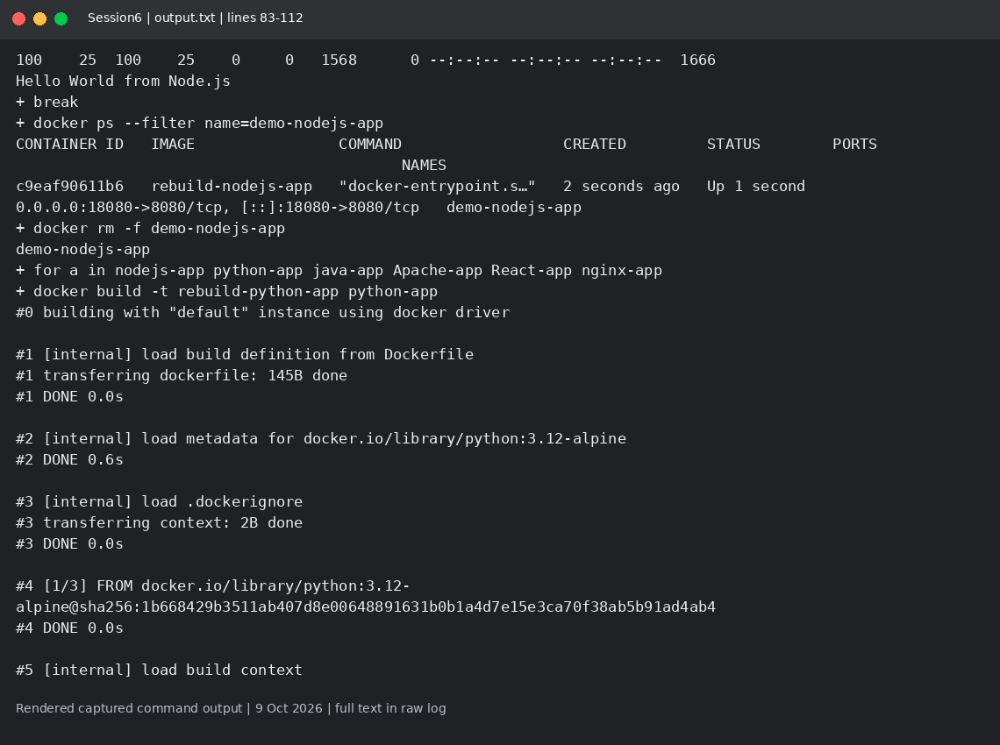
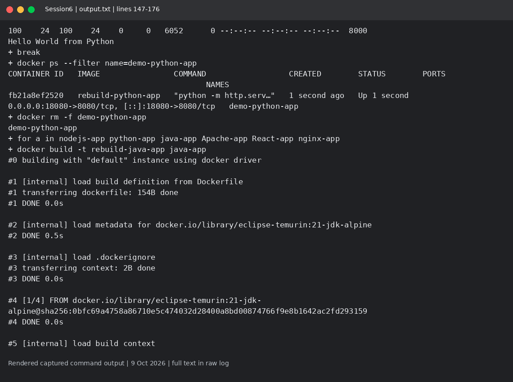
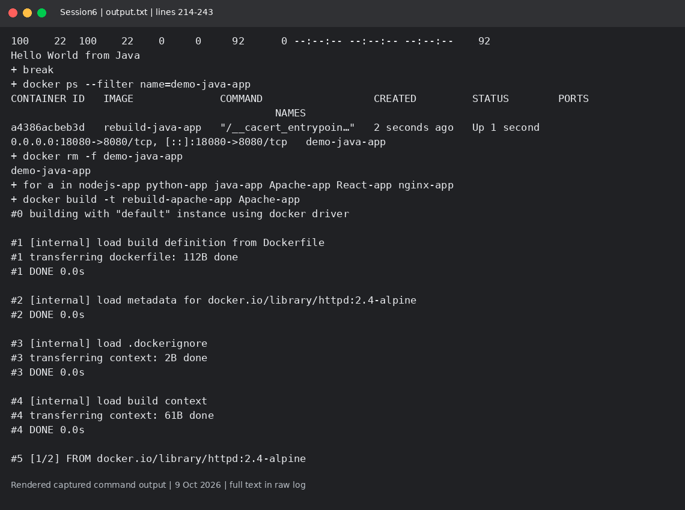
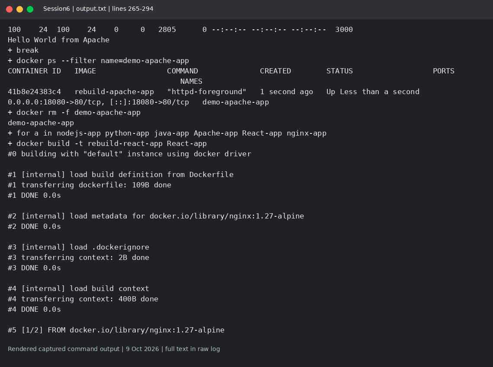
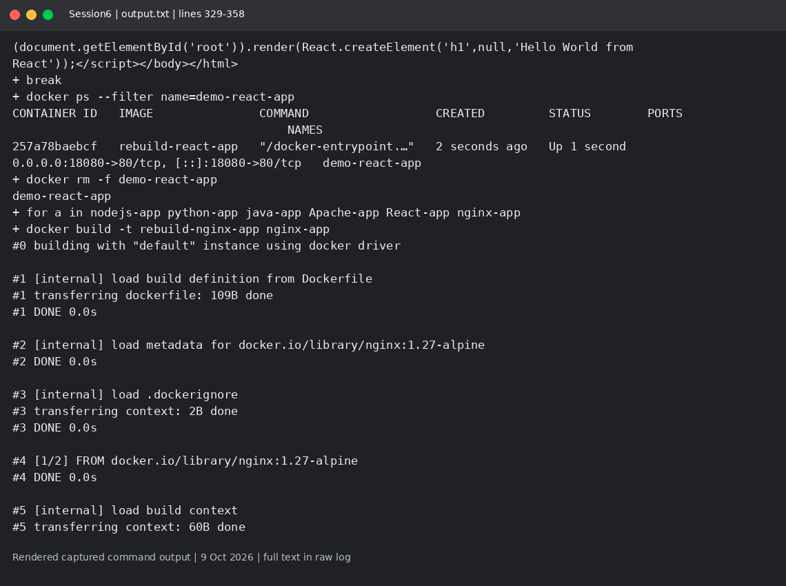
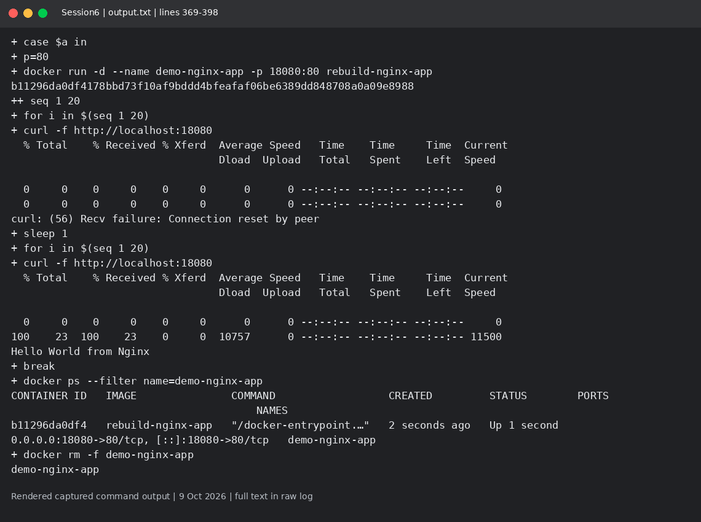
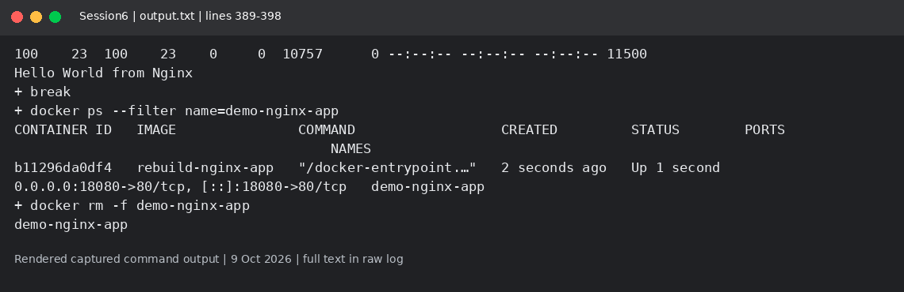

# Session 6: Docker Hello World applications

Mohd Jahur | Enrollment 10319

## Work and observations

1. I built and ran separate Node.js, Python, Java, Apache, React and Nginx images. Source code and Dockerfiles are included.
2. Each container was started with a published port and checked through HTTP. React serves a real React page using CDN scripts; a curl response alone verifies delivery, not browser rendering.

## Evidence

Fresh run on 9 October 2026 in a separate disposable lab. These are rendered views of actual captured command output, not live terminal screenshots. Raw logs are included so the text can be checked.

<!-- EVIDENCE -->

The first build attempt used uppercase image tags for Apache/React and failed. output-first-attempt.txt is retained; output.txt contains the corrected lowercase-tag builds and HTTP responses.

The React source page was also opened in a headless browser on 9 October. This screenshot verifies the React rendering; Docker delivery is independently recorded in output.txt.

## Captured output files

- [output-first-attempt.txt](output-first-attempt.txt)
- [output.txt](output.txt)

