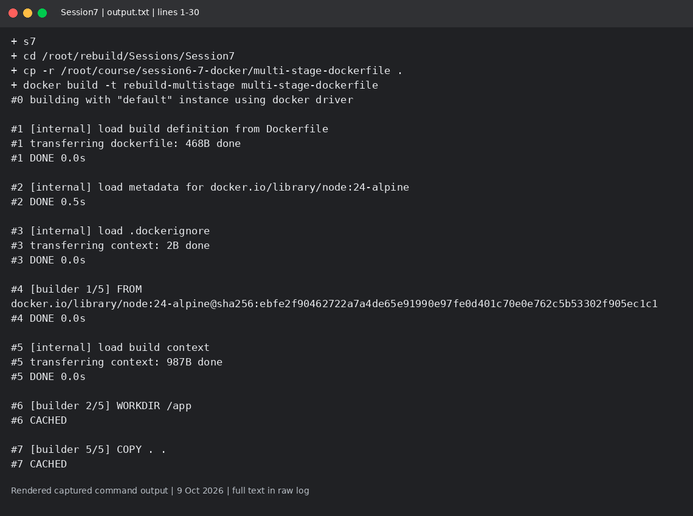
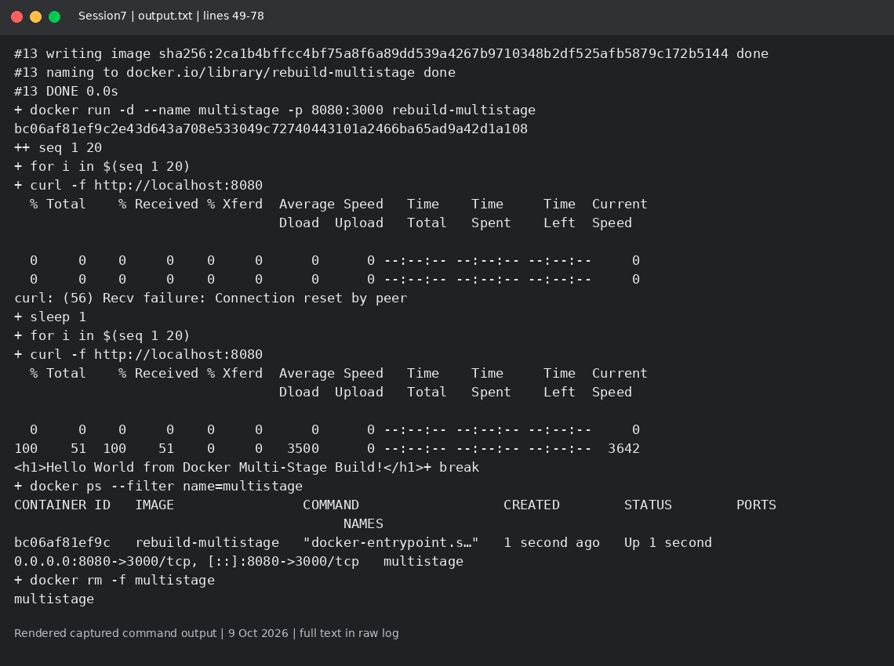

# Session 7: Docker multi-stage build

Mohd Jahur | Enrollment 10319

## Work and observations

1. I rebuilt the course Node.js multi-stage image and ran it with host port 8080 mapped to container port 3000.
2. The first attempt mapped the wrong container port. The corrected run and docker ps output are saved separately; Session6 also contains the three application types required here.

## Evidence

Fresh run on 9 October 2026 in a separate disposable lab. These are rendered views of actual captured command output, not live terminal screenshots. Raw logs are included so the text can be checked.

<!-- EVIDENCE -->

Three application deployments required by this session were also executed in [Session6](../Session6/README.md): Node.js, Python and Java. Their Dockerfiles/source and output are linked there.

## Captured output files

- [output-first-attempt.txt](output-first-attempt.txt)
- [output.txt](output.txt)

