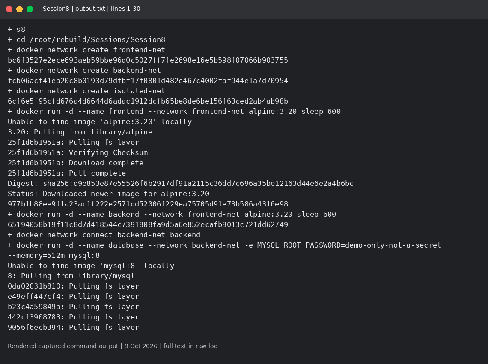
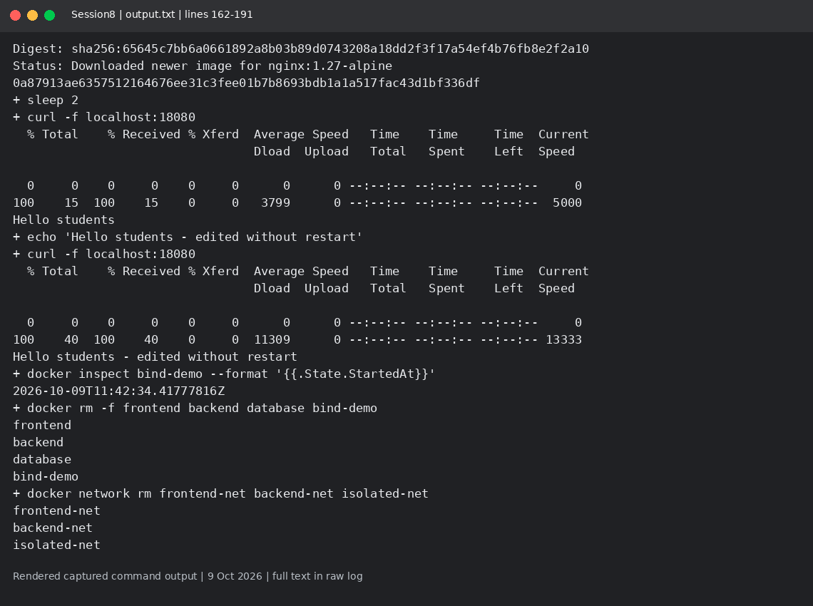

# Session 8: Docker networking and bind mounts

Mohd Jahur | Enrollment 10319

## Work and observations

1. I created three networks, joined the backend to two, and tested frontend-to-backend and backend-to-database connectivity.
2. I ran Apache with host networking and updated an Nginx bind-mounted index.html without restarting the container. An overlay network joins containers on different Docker hosts in a Swarm; no multi-host overlay was run in this lab.

## Evidence

Fresh run on 9 October 2026 in a separate disposable lab. These are rendered views of actual captured command output, not live terminal screenshots. Raw logs are included so the text can be checked.

<!-- EVIDENCE -->

The initial Apache HTTP check was too early and failed. host-network-verified.txt contains the retried host-network HTTP success. Database testing checks container-network reachability; it does not claim a SQL query or full database readiness test.

## References

- https://docs.docker.com/engine/network/drivers/overlay/

## Captured output files

- [host-network-verified.txt](host-network-verified.txt)
- [output.txt](output.txt)

