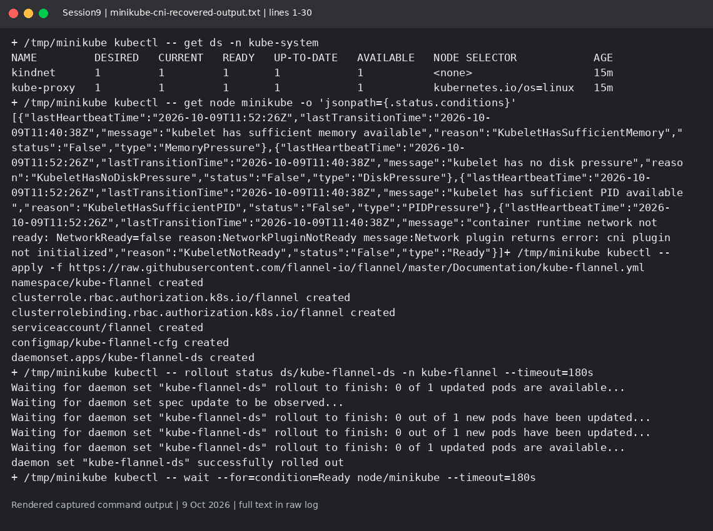
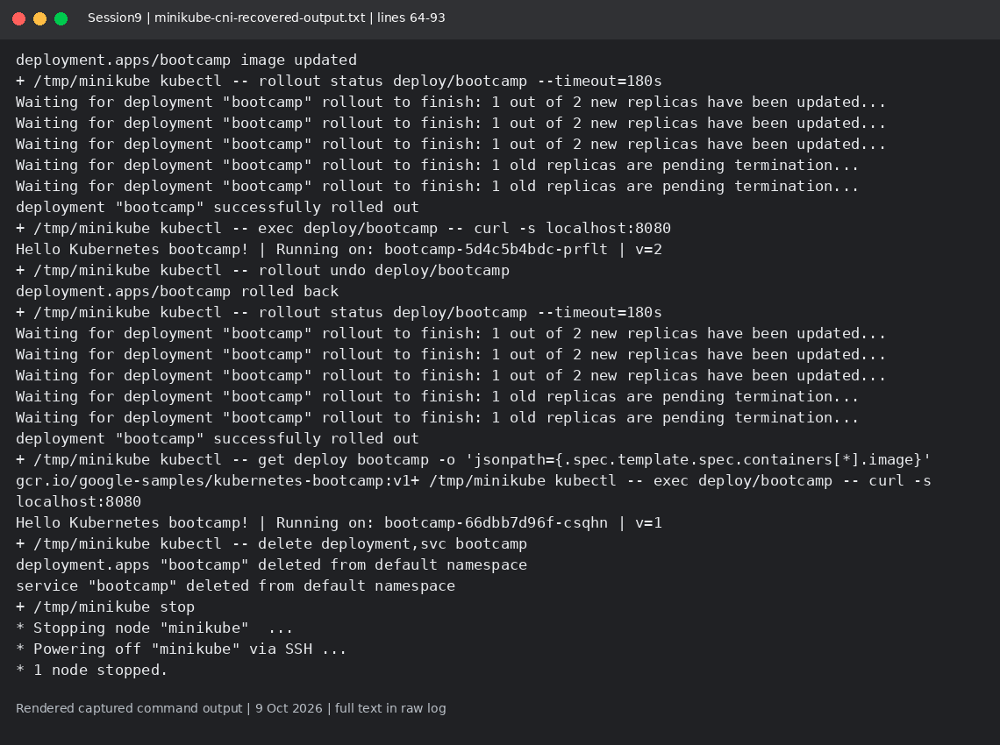

# Session 9: Minikube fundamentals

Mohd Jahur | Enrollment 10319

## Work and observations

1. I started real Minikube inside the separate lab with one CPU and 2GB RAM. The NumCPU preflight override is a lab-only workaround.
2. The tutorial evidence must be read from minikube-cni-recovered-output.txt. The first attempt pointed at the kubeadm kubeconfig and failed; it is preserved as output-first-attempt.txt, not claimed as a success.

## Evidence

Fresh run on 9 October 2026 in a separate disposable lab. These are rendered views of actual captured command output, not live terminal screenshots. Raw logs are included so the text can be checked.

<!-- EVIDENCE -->

## Architecture
The API server receives resource requests; etcd stores cluster state; the scheduler places Pods; controllers reconcile desired state; kubelet runs Pods on each node through a container runtime. Services provide stable routing and CoreDNS provides discovery. Minikube creates a small local Kubernetes cluster for practice. The other session runs use the pre-provided kubeadm cluster, not Minikube.

Sources: https://kubernetes.io/docs/concepts/architecture/ https://minikube.sigs.k8s.io/docs/start/

## Corrected successful run
Minikube initially had an uninitialized network plugin. I installed Flannel and directed its API connection to the nested Minikube API rather than the overlapping kubeadm Service address. minikube-cni-recovered-output.txt shows the node Ready, successful v1/v2/rollback rollouts and HTTP responses v=1, v=2, v=1. A pre-existing Service returned AlreadyExists and was reused, then deleted in cleanup.

## Captured output files

- [minikube-cni-recovered-output.txt](minikube-cni-recovered-output.txt)
- [minikube-final-output.attempt.txt](minikube-final-output.attempt.txt)
- [minikube-final-output.txt](minikube-final-output.txt)
- [minikube-verified-output.txt](minikube-verified-output.txt)
- [output-first-attempt.txt](output-first-attempt.txt)
- [output.attempt.txt](output.attempt.txt)
- [output.txt](output.txt)

